# Local Vision Agent — Comprehensive Architecture & Technical System Manual

**Version:** 1.0.0 (Production Release)  
**System Classification:** Local Multimodal Document & Vision Intelligence Agent  
**Hardware & Runtime Environment:** Local Python 3.13.x, Ollama Vision LLM (`moondream` / `qwen2.5vl:3b` / `llama3.2`), Qdrant Vector Database (`localhost:6333`, 1024-dim BAAI/bge-m3 embeddings).

---

## 1. System Objective & Architecture Overview

The **Local Vision Agent** is a production-grade, local multimodal intelligence engine. It is designed to ingest heterogeneous documents and visual media—ranging from scanned PDFs and photos to complex CAD blueprints, tabular spreadsheets, and technical schematics. The system extracts textual, structural, and visual features, interfaces with an existing local Qdrant vector store of 344,000+ vector chunks, performs rigorous analytical computations with Pandas, generates automated visualizations with Matplotlib/Seaborn, and synthesizes grounded, factual responses via local Vision LLMs without external cloud dependencies.

```mermaid
graph TD
    classDef client fill:#1e293b,stroke:#38bdf8,stroke-width:2px,color:#f8fafc;
    classDef core fill:#0f172a,stroke:#818cf8,stroke-width:2px,color:#f8fafc;
    classDef engine fill:#1e1b4b,stroke:#a855f7,stroke-width:2px,color:#f8fafc;
    classDef storage fill:#064e3b,stroke:#34d399,stroke-width:2px,color:#f8fafc;
    classDef output fill:#451a03,stroke:#fb923c,stroke-width:2px,color:#f8fafc;

    subgraph UserInterface ["1. USER INTERFACE & DISPATCH LAYER"]
        CLI["CLI Entry Point (main.py)"]:::client
        Interactive["Interactive Terminal Wizard (cli/interactive.py)"]:::client
        GUI["Native Desktop Graphical UI (ui/desktop_app.py)"]:::client
        FilePicker["Native File Explorer Dialog (Tkinter / Native OS)"]:::client
    end

    subgraph CoreOrchestration ["2. INGESTION & PIPELINE ORCHESTRATION"]
        FileDetect["Input Detection & Security Validator (utils/file_utils.py)"]:::core
        Router["Intelligent Task Router (core/router.py)"]:::core
        Pipeline["Vision Pipeline Orchestrator (core/pipeline.py)"]:::core
    end

    subgraph DocumentVisionSubsystems ["3. MULTIMODAL EXTRACTION SUBSYSTEMS"]
        DocAnalyzer["Document Analyzer (document/document_analyzer.py)"]:::engine
        PDFProc["PDF Processor & Renderer (document/pdf_processor.py)"]:::engine
        OCRProc["RapidOCR ONNX Engine (document/ocr_processor.py)"]:::engine
        TableProc["Table Extractor (document/table_extractor.py)"]:::engine
        VisionEngine["Vision Agent & Processor (vision/vision_agent.py)"]:::engine
        OllamaLLM["Local Ollama Server (Moondream / Llama 3.2 / Qwen-VL)"]:::engine
    end

    subgraph AnalyticsAndRetrieval ["4. ANALYTICS & RETRIEVAL LAYER"]
        QdrantStore[("Qdrant Vector DB (344,458 vectors @ 1024-dim)")]:::storage
        Retriever["Knowledge Retriever (retrieval/retriever.py)"]:::storage
        Embedder["BAAI/bge-m3 Embedder (retrieval/embeddings.py)"]:::storage
        DataAnalyzer["Pandas / NumPy Data Engine (data/data_analyzer.py)"]:::engine
        ChartGen["Matplotlib / Seaborn Chart Generator (visualization/chart_generator.py)"]:::engine
    end

    subgraph OutputLayer ["5. STRUCTURED ARTIFACT GENERATION"]
        TeeLogger["Tee Dual Logger (Terminal + logs/*.log)"]:::output
        MDReports["Summary & QA Markdown (outputs/summaries/)"]:::output
        ExtractedCSV["Extracted Tables CSV (outputs/extracted/)"]:::output
        ChartsPNG["Generated Visualizations (outputs/visualizations/)"]:::output
    end

    CLI --> Router
    Interactive --> Router
    GUI --> Router
    Interactive -.-> FilePicker
    GUI -.-> FilePicker

    Router --> Pipeline
    Pipeline --> FileDetect
    FileDetect --> DocAnalyzer

    DocAnalyzer --> PDFProc
    DocAnalyzer --> OCRProc
    DocAnalyzer --> TableProc
    DocAnalyzer --> VisionEngine

    VisionEngine <--> OllamaLLM

    Pipeline --> Retriever
    Retriever <--> Embedder
    Retriever <--> QdrantStore

    Pipeline --> DataAnalyzer
    DataAnalyzer --> ChartGen

    Pipeline --> TeeLogger
    Pipeline --> MDReports
    Pipeline --> ExtractedCSV
    Pipeline --> ChartsPNG
```



---

## 2. End-to-End Execution & Data Flow

The following lifecycle traces a document or query through the pipeline from initial input to final artifacts:

```mermaid
sequenceDiagram
    autonumber
    actor User as User / Terminal
    participant UI as CLI / GUI / Interactive Wizard
    participant Pipe as Vision Pipeline
    participant Doc as Document Analyzer
    participant OCR as RapidOCR Engine
    participant Vis as Vision LLM (Ollama)
    participant Qdrant as Qdrant Vector Store
    participant Data as Data Analyzer (Pandas)
    participant Chart as Chart Generator (Seaborn)
    participant Storage as File System & Logs

    User->>UI: Select Task (Summarize, Ask, Visualize, CAD, Direct Query)
    UI->>User: Request File (via Browse Dialog / Path) or Query Text
    User-->>UI: Selects file (e.g. cad_blueprint.pdf) + Query
    UI->>Pipe: run(file_path, command, question)

    rect rgb(30, 41, 59)
        note over Pipe,Doc: Step 1: Input Ingestion & Page Breakdown
        Pipe->>Doc: analyze(file_path)
        Doc->>Doc: Detect file format (PDF, Image, Table, CAD)
        Doc->>Doc: Extract selectable text & render page pixmaps
        Doc->>OCR: Run OCR on image/scanned regions
        OCR-->>Doc: Structured OCR text + Bounding Boxes
        Doc->>Doc: Extract native tables with pdfplumber
        Doc-->>Pipe: ProcessedPage list + TableData list
    end

    rect rgb(15, 23, 42)
        note over Pipe,Vis: Step 2: Visual Understanding & Diagram Analysis
        loop For each rendered page image
            Pipe->>Vis: analyze_chart() / explain_diagram() / describe_image()
            Vis->>Vis: Scale image <= 1280px & Base64 encode
            Vis-->>Pipe: Visual narrative (Title, callouts, layout, dimensions)
        end
    end

    rect rgb(6, 78, 59)
        note over Pipe,Data: Step 3: Tabular Analysis & Auto-Plotting
        alt If tables / numerical data detected
            Pipe->>Data: analyze_table(DataFrame)
            Data-->>Pipe: Statistical summary (Totals, Means, Min/Max, Trends)
            Pipe->>Chart: auto_visualize(DataFrame)
            Chart->>Storage: Save PNG to outputs/visualizations/
            Chart-->>Pipe: Chart PNG file path
        end
    end

    rect rgb(30, 27, 75)
        note over Pipe,Qdrant: Step 4: Grounded Knowledge Retrieval
        Pipe->>Qdrant: retrieve(query_vector from bge-m3, top_k=4)
        Qdrant-->>Pipe: Matching organizational chunks (score, page, file_name)
    end

    rect rgb(69, 26, 3)
        note over Pipe,Storage: Step 5: Grounded Synthesis & Output Formatting
        Pipe->>Vis: Synthesize grounded response (Doc Text + Visuals + Qdrant Chunks)
        Vis-->>Pipe: Grounded structured final answer
        Pipe->>Storage: Save markdown summary to outputs/summaries/
        Pipe->>Storage: Save tables to outputs/extracted/*.csv
        Pipe->>Storage: Dual-write session output via TeeWriter to logs/*.log
        Pipe-->>UI: PipelineResult (Formatted text, citations, generated files)
        UI-->>User: Display Structured Terminal / Desktop GUI Output
    end
```



---

## 3. Detailed File-by-File Work & Responsibilities

The codebase is organized into isolated, single-responsibility modules:

| Directory | File | Primary Responsibility | Key Functions / Methods | Inputs & Outputs |
| :--- | :--- | :--- | :--- | :--- |
| `config/` | `settings.py` | Central typed configuration loaded from `.env` and environment variables. | `Settings.ensure_directories()` | **In:** `.env` variables<br>**Out:** Immutable `settings` dataclass |
| `core/` | `models.py` | Domain dataclasses and Enum definitions for the pipeline. | `TaskType`, `OCRResult`, `TableData`, `ProcessedPage`, `RetrievalChunk`, `PipelineResult` | **In:** Raw data<br>**Out:** Strongly-typed domain objects |
| `core/` | `router.py` | Maps user commands and query intent to specific task processing types. | `TaskRouter.route_command()`, `infer_task_from_query()` | **In:** Command string / query<br>**Out:** `TaskType` enum |
| `core/` | `pipeline.py` | Main pipeline orchestrator connecting parser, OCR, vision, Qdrant, Pandas, and plotting. | `VisionPipeline.run()` | **In:** File path, command, question<br>**Out:** `PipelineResult` |
| `vision/` | `ollama_client.py` | Resilient HTTP client for local Ollama server with timeout & model verification. | `check_connection()`, `verify_model_available()`, `generate()` | **In:** Text prompt, Base64 images<br>**Out:** LLM completion string |
| `vision/` | `image_processor.py` | Normalizes image resolution, handles aspect ratio preservation, Base64 encoding. | `prepare_image()`, `resize_image_if_needed()` | **In:** Image path / bytes / PIL<br>**Out:** (PIL.Image, base64_str) |
| `vision/` | `prompts.py` | Curated system and domain prompts for diagrams, CAD, charts, and grounded QA. | `CHART_ANALYSIS`, `DIAGRAM_ANALYSIS`, `grounded_synthesis()` | **In:** User questions & context<br>**Out:** Formatted prompt strings |
| `vision/` | `vision_agent.py` | High-level interface for visual reasoning over images and rendered pages. | `describe_image()`, `analyze_chart()`, `explain_diagram()`, `answer_question()` | **In:** Image source, prompt<br>**Out:** Visual analysis narrative |
| `document/`| `text_extractor.py` | Extracts native selectable text page-by-page from PDFs and text files. | `extract_from_pdf()`, `extract_from_text_file()` | **In:** PDF / text file path<br>**Out:** Page text dictionaries |
| `document/`| `ocr_processor.py` | Self-contained ONNX-based OCR (RapidOCR) with PyTesseract fallback. | `process_image()` | **In:** PIL Image / rendered page<br>**Out:** `OCRResult` with bboxes & text |
| `document/`| `table_extractor.py`| Native PDF table extraction (pdfplumber) + CSV/Excel loading into DataFrames. | `extract_tables_from_pdf()`, `matrix_to_dataframe()` | **In:** PDF or tabular file<br>**Out:** List of `TableData` |
| `document/`| `pdf_processor.py` | Page counting, native vs scanned detection, 150 DPI page rendering. | `process_pdf()` | **In:** PDF file path<br>**Out:** List of `ProcessedPage` |
| `document/`| `document_analyzer.py`| Unified polymorphic document ingestion router. | `analyze()` | **In:** Any document/image path<br>**Out:** `(type, pages, tables)` |
| `retrieval/`| `qdrant_client.py` | Non-destructive read-only wrapper around local Qdrant instance. | `list_collections()`, `search_vectors()` (via `query_points`) | **In:** Collection name, query vector<br>**Out:** List of matching payload hits |
| `retrieval/`| `embeddings.py` | Generates 1024-dimension BAAI/bge-m3 embeddings matching Qdrant. | `embed_query()`, `embed_texts()` | **In:** Query string<br>**Out:** 1024-dim float list |
| `retrieval/`| `retriever.py` | High-level retriever orchestrating embeddings and Qdrant similarity search. | `retrieve()` | **In:** Natural language query<br>**Out:** List of `RetrievalChunk` |
| `data/` | `dataframe_processor.py`| Cleans headers, strips whitespace, converts numeric columns, generates stats. | `clean_dataframe()`, `summarize_dataframe()` | **In:** Raw DataFrame<br>**Out:** Clean DataFrame & stats dict |
| `data/` | `data_analyzer.py` | Computes column totals, averages, min/max rows, and multi-period trends. | `analyze_table()` | **In:** Clean DataFrame<br>**Out:** Insights list & summary dict |
| `visualization/`| `chart_generator.py`| Safe, parameter-validated plotting with Matplotlib/Seaborn (Bar, Line, Pie). | `plot_bar()`, `plot_line()`, `plot_pie()`, `auto_visualize()` | **In:** DataFrame, column names<br>**Out:** Saved PNG file path |
| `cli/` | `commands.py` | CLI command dispatcher and structured output console formatter. | `format_output()`, `handle_summarize()`, `handle_direct_query()` | **In:** Command args<br>**Out:** Formatted terminal display |
| `cli/` | `interactive.py` | Interactive terminal wizard with menu and native Windows file picker. | `run_interactive_wizard()`, `open_file_browser()` | **In:** Terminal keyboard input<br>**Out:** Interactive execution loop |
| `ui/` | `desktop_app.py` | Native Tkinter graphical application with live visual preview & background thread. | `VisionAgentApp`, `launch_desktop_ui()` | **In:** GUI clicks, file browser<br>**Out:** Desktop GUI window |
| `utils/` | `file_utils.py` | File format detection, path traversal security checks, safe name generation. | `detect_file_type()`, `validate_file_path()`, `safe_output_path()` | **In:** File path<br>**Out:** Validated `Path` / safe path |
| `utils/` | `image_utils.py` | PIL Image loader (RGBA->RGB), memory-safe thumbnailing, Base64 encoder. | `load_image_safely()`, `encode_image_to_base64()` | **In:** Image source<br>**Out:** Base64 string / PIL Image |
| `utils/` | `logging_utils.py`| Implements `TeeWriter` for simultaneous terminal printing and session file logging. | `setup_tee_logger()`, `get_logger()` | **In:** Text stream<br>**Out:** Terminal + `logs/*.log` |
| `main.py` | `main.py` | Main CLI entry point handling command arguments, flags, and wizard dispatch. | `build_parser()`, `main()` | **In:** Terminal arguments<br>**Out:** Dispatched execution |

---

## 4. System Capabilities Matrix

```
┌────────────────────────────────────────────────────────────────────────────────────────┐
│                              LOCAL VISION AGENT CAPABILITIES                           │
├──────────────────────────────┬─────────────────────────────────────────────────────────┤
│ Modality / Feature           │ Capability Description & Implementation                 │
├──────────────────────────────┼─────────────────────────────────────────────────────────┤
│ Standard & Multi-Page PDFs   │ Page-by-page native text extraction, preserving exact   │
│                              │ page numbers and boundaries.                            │
├──────────────────────────────┼─────────────────────────────────────────────────────────┤
│ Scanned & Image-only PDFs    │ 150 DPI page rasterization + RapidOCR ONNX text         │
│                              │ extraction and bounding box detection.                  │
├──────────────────────────────┼─────────────────────────────────────────────────────────┤
│ CAD Blueprints & Drawings    │ Technical drawing comprehension, title-block parsing,   │
│                              │ dimension extraction, tolerance & BOM reading.          │
├──────────────────────────────┼─────────────────────────────────────────────────────────┤
│ High-Resolution Images       │ PNG, JPG, WEBP, BMP, TIFF ingestion with automatic      │
│                              │ aspect-ratio preserving downscaling <= 1280px.          │
├──────────────────────────────┼─────────────────────────────────────────────────────────┤
│ Charts, Plots & Dashboards   │ Bar, Line, Pie, Scatter, and Histogram visual           │
│                              │ understanding, legend reading, axis and peak detection. │
├──────────────────────────────┼─────────────────────────────────────────────────────────┤
│ Tabular Data Extraction      │ Native PDF table recognition + CSV/Excel loading into   │
│                              │ Pandas DataFrames, exported automatically to CSV.       │
├──────────────────────────────┼─────────────────────────────────────────────────────────┤
│ Data Analytics & Trends      │ Calculation of column totals, means, min/max values,    │
│                              │ percentage changes, and multi-row trend recognition.    │
├──────────────────────────────┼─────────────────────────────────────────────────────────┤
│ Automated Data Visualization │ Automated generation of publication-quality Seaborn     │
│                              │ Bar/Line/Pie plots saved to outputs/visualizations/.    │
├──────────────────────────────┼─────────────────────────────────────────────────────────┤
│ Existing Qdrant Retrieval    │ Non-destructive semantic search over 344k vectors using │
│                              │ 1024-dim BGE-M3 embeddings, citing source & score.      │
├──────────────────────────────┼─────────────────────────────────────────────────────────┤
│ Dual Interface Support       │ Terminal Interactive Wizard + Native Desktop GUI window │
│                              │ with Windows File Explorer file picker dialog.          │
├──────────────────────────────┼─────────────────────────────────────────────────────────┤
│ Dual Logging (Tee Engine)    │ Automatic real-time duplication of stdout/stderr to     │
│                              │ timestamped session log files in logs/.                 │
└──────────────────────────────┴─────────────────────────────────────────────────────────┘
```

---

## 5. Sample Inputs & Real Execution Outputs

### Sample 1: CAD Blueprint Ingestion & Analysis
**Input File:** `inputs/cad_engineering_blueprint.pdf` (Mechanical Flange Assembly Drawing)

```text
============================================================
                   VISION AGENT RESULT                    
============================================================

Input:
  cad_engineering_blueprint.pdf

Detected Type:
  PDF

Processing:
  File Ingestion + Text Extraction + Vision LLM + Pandas Analytics + Qdrant Retrieval

Pages:
  1

Summary:
  High-Pressure Flange Assembly Blueprint

  * Part: High-Pressure Flange Assembly
  * DWG No: DWG-ENG-2026-4401
  * REV: D (Approved)
  * Scale: 1:2
  * Material: 316L Stainless Steel
  * Rating: Class 600 (1480 PSI)

  Bill of Materials (BOM):
  * Item 1: Flange Body Weld Neck (4in, 316L SS, Qty 2)
  * Item 2: Spiral Wound Gasket (4.0in, Graphite/316L, Qty 1)
  * Item 3: Stud Bolts (7/8in x 5.5in, ASTM A193 B8M, Qty 8)
  * Item 4: Heavy Hex Nuts (7/8in, ASTM A194 Gr 8M, Qty 16)

  Engineering Notes:
  * Dimensions in inches unless otherwise specified.
  * Hydrostatic pressure test required at 2220 PSI for 30 minutes.
  * 100% radiographic examination (RT) on all circumferential butt welds.
  * Gasket seating surface to have spiral serrated finish (125-250 Ra).
  * Fasteners to be torqued to 225 ft-lbs in crisscross pattern.

Key Findings:
  1. Extracted 3 Bill of Materials tables to clean CSV.
  2. Total fastners & components count: 27 units.

Retrieved Context (from Qdrant securegpt_corpus):
  - [Document: CAD_Part_Release_Log.csv | Dept: Operations | Score: 0.585]
  - [Document: Automotive_Engineering_Catalog.csv | Dept: Operations | Score: 0.574]

Visual Findings:
  Page 1: Section elevation view of mechanical flange assembly with centerline, 4.00" inner bore, 8.50" bolt circle with 8 hole callouts, and gasket seating joint.

Generated Files:
  - outputs\extracted\cad_engineering_blueprint_table_p1_1.csv
  - outputs\extracted\cad_engineering_blueprint_table_p1_2.csv
  - outputs\extracted\cad_engineering_blueprint_table_p1_3.csv
  - outputs\summaries\cad_engineering_blueprint_summary.md

============================================================
```

---

### Sample 2: Tabular Data Ingestion & Automated Chart Generation
**Input File:** `outputs/temporary/sample_sales.csv`

```csv
Region,Revenue,Growth
North,45000,12.5
South,52000,8.2
East,31000,-3.1
West,68000,19.4
```

**CLI Execution:** `python main.py visualize outputs/temporary/sample_sales.csv`

```text
============================================================
                   VISION AGENT RESULT                    
============================================================

Input:
  sample_sales.csv

Detected Type:
  TABLE_DATA

Processing:
  File Ingestion + Text Extraction + Pandas Analytics + Qdrant Retrieval

Pages:
  1

Answer / Summary:
  --- Page 1 ---
| Region   |   Revenue |   Growth |
|:---------|----------:|---------:|
| North    |     45000 |     12.5 |
| South    |     52000 |      8.2 |
| East     |     31000 |     -3.1 |
| West     |     68000 |     19.4 |

Key Findings:
  1. Column 'Revenue': Total = 196,000.00, Average = 49,000.00, Min = 31,000.00, Max = 68,000.00
  2.   -> Highest Revenue is for 'West' (68,000.00)
  3.   -> Lowest Revenue is for 'East' (31,000.00)
  4. Column 'Growth': Total = 37.00, Average = 9.25, Min = -3.10, Max = 19.40
  5.   -> Highest Growth is for 'West' (19.40)
  6.   -> Lowest Growth is for 'East' (-3.10)
  7. Trend for 'Revenue': increased from 45,000.00 to 68,000.00 (+51.11%)
  8. Generated visualization chart saved to: bar_chart_20260901_194502.png

Retrieved Context (from Qdrant):
  - [Document: SFDC-CRM_Architecture_1.md | Dept: Technology_Digital (Score: 0.657)]
  - [Document: SFDC-CRM_Architecture_2.md | Dept: Technology_Digital (Score: 0.651)]

Generated Files:
  - outputs\extracted\sample_sales_table_p1_1_2.csv
  - outputs\visualizations\bar_chart_20260901_194502.png
  - outputs\summaries\sample_sales_summary_2.md

============================================================
```

---

### Sample 3: Direct Knowledge Query across 344k Qdrant Vectors
**CLI Execution:** `python main.py query "What are the financial forecast reports in Executive Corporate?"`

```text
============================================================
               KNOWLEDGE BASE QUERY RESULT                
============================================================

User Query:
  What are the financial forecast reports in Executive Corporate?

Answer:
  Executive Corporate financial reports provide consolidated views of strategic objectives, enterprise KPIs, financial impact, and scenario analyses across multi-year histories. Key elements include revenue forecasts, operational budgets, variance analyses, and data governance validation evidence.

Retrieved Sources (from Qdrant securegpt_corpus):
  - [Document: Financial_Forecast_Report_Q1_2023.pdf | Page: 12 | Dept: Executive_Corporate (Score: 0.645)]
  - [Document: Financial_Forecast_Report_Q2_2019.pdf | Page: 11 | Dept: Executive_Corporate (Score: 0.638)]
  - [Document: Annual_CDO_Performance_Report_2025.docx | Page: N/A | Dept: Technology_Digital (Score: 0.631)]

Saved Answer to: outputs\summaries\query_answer.md

============================================================
```

---

## 6. Security & Engineering Guardrails

1. **Zero Dynamic Code Execution:** The system never evaluates arbitrary Python strings produced by the LLM (`eval()`, `exec()`, and `os.system()` are strictly banned). All chart generation uses internal parameter-validated templates.
2. **Path Traversal Protection:** Input and output paths are strictly validated using `pathlib.Path.resolve()`, preventing directory traversal exploits.
3. **Non-Destructive Qdrant Operations:** The Qdrant wrapper enforces read-only operations (`query_points`, `get_collections`, `scroll`), safeguarding all 344,458 existing vector points against accidental deletion or schema changes.
4. **Resolution Memory Capping:** Input images and rendered pages are capped to `MAX_IMAGE_DIMENSION=1280` pixels, preventing memory exhaustion when passing inputs to the local Ollama vision server.
